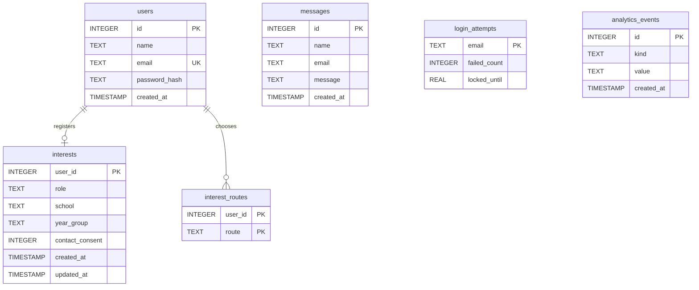

# SQL Schema

The site stores its data in one SQLite database file, `site.db`, next to `main.py`. `init_db()` in `main.py` creates the six tables with `CREATE TABLE IF NOT EXISTS` the first time `get_db()` opens the database. There is no migration tool, so a change to an existing table has to be applied to existing databases by hand, or the file deleted and recreated.

What each field is for, how it is checked, who can see it and how long it is kept is in [Data Requirements](https://pippin.amazon.dev/docs/s2xmtgi20LNgRh).

## Tables

- `users`: one row per account.
- `messages`: one row per contact form message.
- `login_attempts`: wrong-password counts and locks, one row per email typed into the sign-in form.
- `analytics_events`: anonymous visitor events for the analytics page (searches, route tabs opened, quiz results).
- `interests`: one row per user who registered interest in a T Level placement.
- `interest_routes`: one row per T Level route a user chose when registering interest.

## Relationships

- `interests.user_id` and `interest_routes.user_id` refer to `users.id`. A user has at most one `interests` row and any number of `interest_routes` rows.
- `login_attempts` is keyed by email, not by user id. Wrong passwords are counted for any email typed in, whether or not it has an account, so an unregistered email locks exactly like a real one.
- `messages` and `analytics_events` are not linked to any user. A contact message is kept even if an account with the same email is deleted.
- SQLite only enforces `REFERENCES` when `PRAGMA foreign_keys` is on, and the app doesn't turn it on. The code keeps the tables consistent itself: `remove_interest()` deletes from both interest tables, and deleting an account removes its interest, its `login_attempts` row and then the `users` row.



## Table definitions

This is the SQL in `init_db()`, as built.

```sql
CREATE TABLE IF NOT EXISTS users (
    id INTEGER PRIMARY KEY AUTOINCREMENT,
    name TEXT NOT NULL,
    email TEXT NOT NULL UNIQUE,
    password_hash TEXT NOT NULL,
    created_at TIMESTAMP DEFAULT CURRENT_TIMESTAMP
);

CREATE TABLE IF NOT EXISTS messages (
    id INTEGER PRIMARY KEY AUTOINCREMENT,
    name TEXT NOT NULL,
    email TEXT NOT NULL,
    message TEXT NOT NULL,
    created_at TIMESTAMP DEFAULT CURRENT_TIMESTAMP
);

-- Failed sign-ins per lower-cased email typed in, whether or not it has an account.
-- failed_count resets on success or lock; locked_until is a Unix time (0 = not locked).
CREATE TABLE IF NOT EXISTS login_attempts (
    email TEXT PRIMARY KEY,
    failed_count INTEGER NOT NULL DEFAULT 0,
    locked_until REAL NOT NULL DEFAULT 0
);

-- Things visitors do in the browser, shown on the analytics page.
-- No user id or IP is stored, only what happened.
CREATE TABLE IF NOT EXISTS analytics_events (
    id INTEGER PRIMARY KEY AUTOINCREMENT,
    kind TEXT NOT NULL,          -- "search", "view" (a route tab opened) or "quiz" (the quiz's top match).
    value TEXT NOT NULL,         -- The search text, or the route name, e.g. "digital".
    created_at TIMESTAMP DEFAULT CURRENT_TIMESTAMP
);

-- Register your interest: one row per user, plus one interest_routes row per route chosen.
CREATE TABLE IF NOT EXISTS interests (
    user_id INTEGER PRIMARY KEY REFERENCES users(id),
    role TEXT NOT NULL,          -- A key from INTEREST_ROLES, e.g. "student".
    school TEXT NOT NULL DEFAULT '',
    year_group TEXT NOT NULL,    -- A key from YEAR_GROUPS, e.g. "year_12".
    contact_consent INTEGER NOT NULL,  -- Always 1: nothing is saved without consent.
    created_at TIMESTAMP DEFAULT CURRENT_TIMESTAMP,
    updated_at TIMESTAMP DEFAULT CURRENT_TIMESTAMP
);

CREATE TABLE IF NOT EXISTS interest_routes (
    user_id INTEGER NOT NULL REFERENCES users(id),
    route TEXT NOT NULL,         -- A key from ROUTES, e.g. "digital".
    PRIMARY KEY (user_id, route)
);
```

## Notes

- `created_at` and `updated_at` use SQLite's `CURRENT_TIMESTAMP`, which is UTC.
- Emails are lower-cased before they are saved or looked up, so the `UNIQUE` rule on `users.email` also catches `Bob@x.com` and `bob@x.com`.
- SQLite doesn't enforce text lengths. The limits (name 100 characters, email 254, message 2000, school 100, search 100) are checked in `main.py` before anything is saved.
- `role`, `year_group`, `route` and the `value` of `view` and `quiz` events are stored as fixed keys from lists in `main.py` (`INTEREST_ROLES`, `YEAR_GROUPS`, `ROUTES`). Any other value is refused, so the tables can't fill up with junk.
- Every query uses `?` placeholders, never string formatting, which stops SQL injection.
- The scaled design replaces SQLite with Amazon RDS in a private subnet (a stretch goal, see the Cloud folder).
